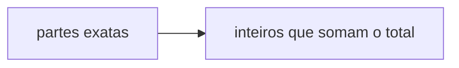

# apportion

## Visão geral

Arredonda partes exatas para inteiros cuja soma é a soma exata arredondada (método do maior resto).

## Responsabilidades

- Garantir que as peças somem exatamente o valor do job em cada componente.
- Desempatar sempre pelo menor índice, tornando o resultado repetível.

## Entradas e saídas

```ts
export function apportion(exact: readonly number[]): number[]
```

## Fluxo principal



## Tratamento de erros e casos-limite

Entrada vazia devolve lista vazia. Valores não negativos. A entrada não é alterada.

## Exemplos

```ts
apportion([1.2, 1.7, 1.1]) // [1, 2, 1]
```

## Dependências e integrações

Nenhuma.
