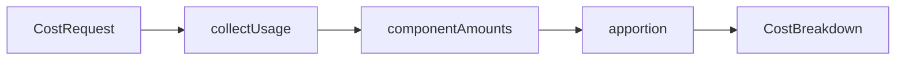

# buildCostBreakdown

## Visão geral

Núcleo síncrono e puro do custo: transforma o pedido em quebra de custos por job, chapa, peça e tipo de peça.

## Responsabilidades

- Coletar o uso, calcular os valores exatos e arredondá-los por categoria com `apportion`, de modo que as peças somem o job.
- Somar chapas a partir das peças e o job a partir das chapas.
- Listar os valores distribuídos (`distributed`) e levantar o aviso `UNALLOCATED_DISTRIBUTED`.
- Marcar cada componente como completo, estimado ou incompleto (sem valor), calcular o estado dos totais e o subtotal parcial.
- Devolver `breakdown: null` com aviso específico para artefato sem layout, versão de contrato não suportada ou modelo de custo inválido.
- Incluir o resumo de produção (`buildProductionReport`) e avisos `UNPLACED_NOT_CHARGED` para os itens não alocados.
- Nunca recalcular layout, sequência ou métricas e nunca alterar a entrada.

## Entradas e saídas

```ts
export function buildCostBreakdown(request: CostRequest): { breakdown: CostBreakdown | null; production: ProductionReport | null; notices: CostNotice[] }
```

## Fluxo principal



## Tratamento de erros e casos-limite

Artefato sem layout devolve `breakdown: null`.

## Exemplos

```ts
const { breakdown } = buildCostBreakdown({ artifact, layout, cutPlan, costModel })
```

## Dependências e integrações

`./collectUsage`, `./componentAmounts`, `./apportion`, `./buildProductionReport`, `./statusNotices`, `./validateCostModel` e `./messages`.
