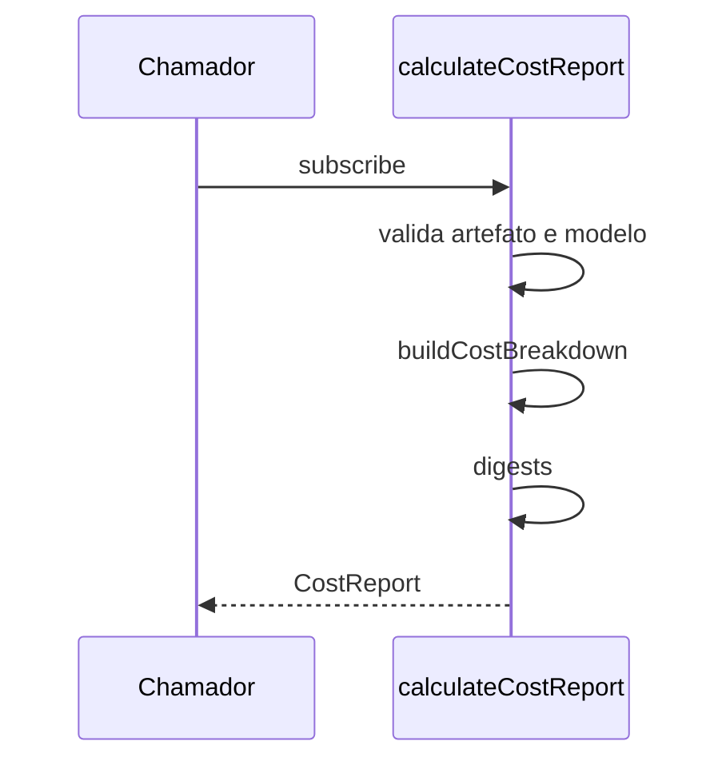

# calculateCostReport

## Visão geral

Fluxo assíncrono do custo: devolve, como Observable frio, um único `CostReport` serializável e auditável, e completa.

## Responsabilidades

- Validar o artefato com o schema ERP da 006 (artefato inválido rejeita o Observable, como o fluxo de nesting).
- Validar a estrutura do modelo de custo; modelo inválido, artefato sem layout ou versão não suportada geram relatório `unavailable` com avisos específicos.
- Acrescentar correlação, digests do artefato, digest do modelo de custo e o digest do próprio relatório (JSON canônico, SHA-256).
- Ordenar os avisos por severidade, código e chave da peça; entradas iguais produzem relatórios idênticos.

## Entradas e saídas

```ts
export function calculateCostReport(request: CostRequest): Observable<CostReport>
```

## Fluxo principal



## Tratamento de erros e casos-limite

Nada é lido antes da inscrição. O relatório não contém horário nem valores que variem entre execuções.

## Exemplos

```ts
const report = await firstValueFrom(calculateCostReport({ artifact, layout, cutPlan, costModel }))
```

## Dependências e integrações

`rxjs`, `../async/observableFlow`, `../erp/digest`, `./buildCostBreakdown` e `./schemas`.
