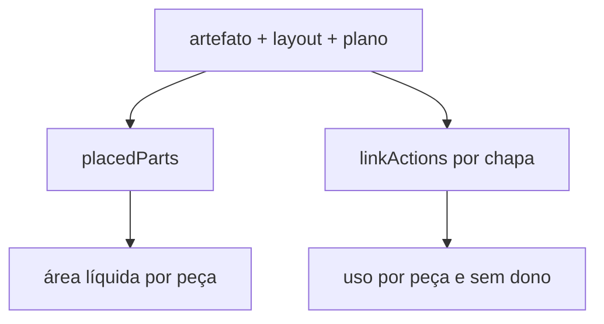

# collectUsage

## Visão geral

Mede, para cada peça posicionada, a área líquida e o uso das ações vinculadas, e reúne por chapa as ações sem dono. Módulo interno do cálculo de custo.

## Responsabilidades

- Usar `placedParts` e `linkActions` (compartilhados com a revisão) para o vínculo ação→peça.
- Calcular a área líquida por `isOuter` e `Math.abs(area)` (externo soma, furo subtrai), sem confiar no sinal guardado; sem layout, usar a área do contorno com o aviso `AREA_WITHOUT_HOLES`.
- Classificar as ações em corte, deslocamento e perfuração e medir o comprimento com `actionLength`.
- Avisar com `PART_AREA_APPROXIMATE` quando a área vem de um contorno que é só o retângulo envolvente.
- Levantar `UNKNOWN_PART`, `UNLINKED_ACTION`, `PART_WITHOUT_AREA`, `PART_WITHOUT_CUTTING`, `PLAN_SHEET_MISSING`, `NO_CUT_PLAN` e `PLACEMENT_SHEET_UNRESOLVED`.

## Entradas e saídas

```ts
export function collectUsage(request: CostRequest): UsageResult
```

## Fluxo principal



## Tratamento de erros e casos-limite

Itens não alocados não geram peça. Sem layout no artefato o resultado não tem chapas. O pedido nunca é alterado.

## Exemplos

```ts
const usage = collectUsage(request)
```

## Dependências e integrações

`../linking/placedParts`, `../linking/linkActions`, `../linking/actionCategory`, `../linking/actionLength`, `../linking/metadataNumber`, `../polygonUtils` e `./messages`.
