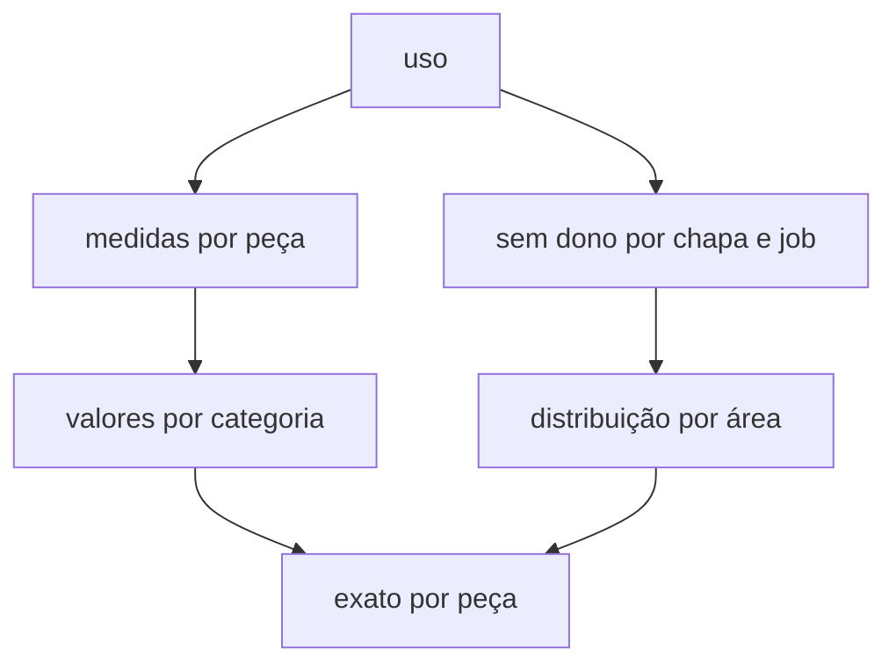

# componentAmounts

## Visão geral

Calcula o valor exato (sem arredondar), em unidades menores da moeda, de cada categoria de custo para cada peça posicionada.

## Responsabilidades

- Material: preço da chapa inteira ou do retalho, distribuído às peças da chapa pela área líquida; se nenhuma peça tem área positiva, em partes iguais.
- Corte, perfuração, deslocamento, consumíveis e mão de obra a partir de tempo, contagem e taxas.
- Valores sem peça dona (ações sem vínculo, manuseio por chapa e por job) distribuídos às peças do escopo pela área líquida e listados em `distributed`.

## Entradas e saídas

```ts
export function componentAmounts(usage: UsageResult, model: CostModel): ComponentAmounts
```

## Fluxo principal



## Tratamento de erros e casos-limite

Chapa sem peças não é cobrada. Taxa zero gera valor zero. Uma categoria com insumo ausente não é calculada: seus valores ficam em zero e o estado (`status`) explica o motivo; as demais categorias seguem normalmente.

## Exemplos

```ts
const { exact, distributed } = componentAmounts(usage, model)
```

## Dependências e integrações

`./estimateTimes`, `./collectUsage` e `./types`.
