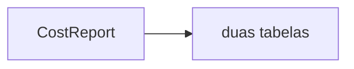

# costReportTables

## Visão geral

Projeta o relatório de custo em duas tabelas de exportação com colunas fixas: uma linha por peça posicionada (`parts`) e as métricas do job e de cada chapa (`job`).

## Responsabilidades

- `parts`: chave, forma, instância, chapa, área líquida, comprimentos, perfurações, tempos, os seis componentes, total, estado e moeda.
- `job`: linhas do job primeiro e depois de cada chapa, com métricas `cost.*` e `time.*` em ordem fixa; as métricas `production.*` só no escopo do job.
- Valores em dinheiro são inteiros em unidades menores; comprimentos, áreas e segundos são textos com exatamente três casas; valor incompleto é `null`.

## Entradas e saídas

```ts
export function costReportTables(report: CostReport): { parts: CostTable; job: CostTable }
```

### Colunas e métricas (ordem fixa)

Tabela `parts` (20 colunas): `part_key`, `shape_id`, `instance_index`, `sheet_id`, `net_area`,
`cut_length`, `travel_length`, `pierce_count`, `cutting_seconds`, `travel_seconds`, `pierce_seconds`,
`material`, `cutting`, `pierce`, `travel`, `consumable`, `labour`, `total`, `status`, `currency`.

Tabela `job` (6 colunas): `scope` (`job` ou `sheet`), `scope_id` (vazio para o job), `metric`, `status`,
`value`, `currency`.

Métricas de cada escopo, nesta ordem: `cost.material`, `cost.cutting`, `cost.pierce`, `cost.travel`,
`cost.consumable`, `cost.labour`, `cost.total`, `cost.partial_subtotal`, `time.cutting_seconds`,
`time.travel_seconds`, `time.pierce_seconds`, `time.handling_seconds`, `time.total_seconds`. O escopo do
job acrescenta, depois delas: `production.sheets_used`, `production.yield`, `production.waste_area`,
`production.total_area`, `production.unplaced_quantity`.

## Fluxo principal



## Tratamento de erros e casos-limite

Relatório indisponível gera tabelas apenas com o cabeçalho.

## Exemplos

```ts
const { parts, job } = costReportTables(report)
```

## Dependências e integrações

`./types`.
