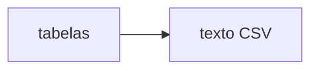

# costReportToCsv

## Visão geral

Escreve as tabelas de exportação como texto RFC 4180: UTF-8, vírgula, quebra de linha LF, linha de cabeçalho, ponto decimal.

## Responsabilidades

- Células vazias para valores incompletos.
- Aspas duplicadas dentro de campos entre aspas; campos com vírgula, aspas ou quebra de linha são sempre entre aspas.
- Saída independente do idioma do processo.

## Entradas e saídas

```ts
export function costReportToCsv(report: CostReport): { parts: string; job: string }
```

## Fluxo principal



## Tratamento de erros e casos-limite

Ao reler o arquivo, a soma dos valores de `parts` por categoria reproduz os valores do `job` exatamente.

## Exemplos

```ts
const { parts, job } = costReportToCsv(report)
```

## Dependências e integrações

`./costReportTables` e `./types`.
