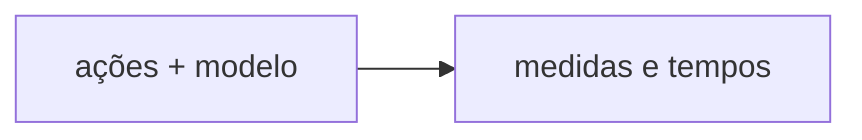

# estimateTimes

## Visão geral

Mede comprimentos e contagem de perfurações e estima o tempo de corte, de deslocamento e de perfuração de um conjunto de ações.

## Responsabilidades

- Converter o comprimento (unidades de geometria) e a velocidade (m/min) em segundos com `geometryUnitsPerMeter`.
- Dar precedência ao `feed` e ao `dwell` numéricos da própria ação sobre os valores do modelo.
- Devolver `null` quando a velocidade ou o tempo de perfuração necessário não existe, nunca um palpite.

## Entradas e saídas

```ts
export function estimateTimes(actions: readonly ActionUsage[], model: CostModel): ActionMeasures
```

## Fluxo principal



## Tratamento de erros e casos-limite

Comprimento zero gera zero segundo mesmo sem velocidade. Velocidade menor ou igual a zero resulta em `null`.

## Exemplos

```ts
const { cuttingSeconds } = estimateTimes(part.actions, model)
```

## Dependências e integrações

`./collectUsage` (tipos) e `./types`.
