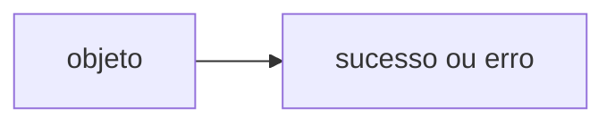

# Schemas Zod do custo

## Visão geral

Schemas Zod do modelo de custo e do pedido, alinhados aos tipos exportados. O pedido reaproveita o schema do artefato da 006.

## Responsabilidades

- Validar a estrutura do modelo (`costModelSchema`) e do pedido (`costRequestSchema`).
- Deixar a validação de faixas de valores para `validateCostModel`.

## Entradas e saídas

```ts
export const costModelSchema
export const costRequestSchema
```

## Fluxo principal



## Tratamento de erros e casos-limite

`contractVersion` do modelo só aceita `1`. O Zod já é dependência aprovada pela ADR-0002.

## Exemplos

```ts
costModelSchema.safeParse(model).success
```

## Dependências e integrações

`zod` e `../erp/schemas`.
