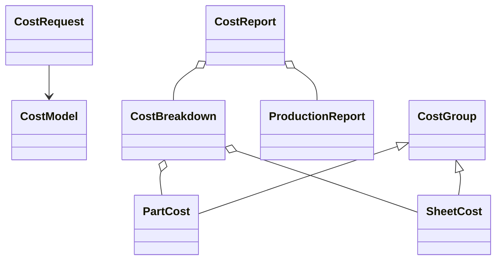

# Tipos de custo e relatório

## Visão geral

Declara os tipos públicos do cálculo de custo de um nesting concluído: modelo de custo, pedido, componentes, relatório de produção, relatório de custo e avisos.

## Responsabilidades

- Definir contratos imutáveis consumidos pelo cálculo, pelo fluxo e pela exportação.
- Reutilizar `CutLayout`, `CutPlanResult`, `ErpCorrelation`, `ErpDigest` e `ErpNestingArtifact` sem redefini-los.
- Listar os códigos de aviso (`CostNoticeCode`), incluindo `PART_AREA_APPROXIMATE`.
- Manter valores monetários como inteiros na menor unidade da moeda (`amount`).

## Entradas e saídas

- Entrada: `CostRequest` (`artifact`, `layout?`, `cutPlan?`, `costModel`).
- Saída: `CostReport` com `breakdown`, `production`, `notices` e os digests de auditoria.

## Fluxo principal



## Tratamento de erros e casos-limite

`CostComponent.amount` é `null` exatamente quando `status` é `incomplete`. Valores marcados com `estimated: true` tornam estimados os componentes que os usam.

## Exemplos

```ts
const category: CostCategory = 'cutting'
```

## Dependências e integrações

`../cutPath/types` e `../erp/types`.
