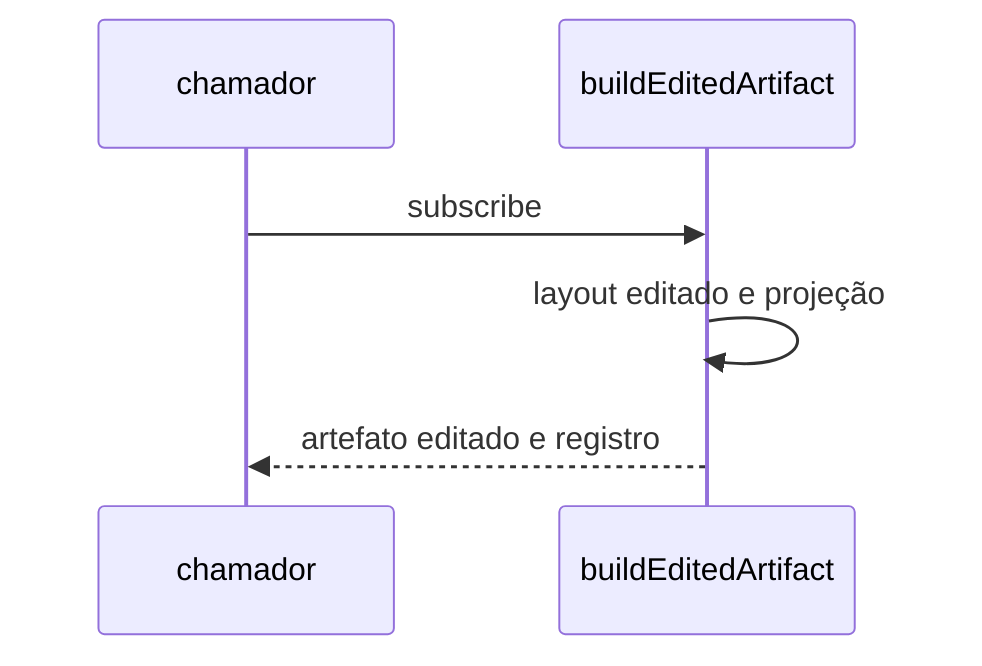

# edit/buildEditedArtifact

## Visão geral

Produz o layout editado como um novo artefato que refere o original, com o registro de edições e um digest próprio.

## Responsabilidades

- Manter correlação, instantâneos e digest de entrada, e calcular o novo digest de saída com a mesma projeção do artefato da ERP.
- Guardar os digests do original e somente as edições aplicadas, em ordem.
- Devolver o digest de saída original quando não há edições aplicadas.

## Entradas e saídas

```ts
export function buildEditedArtifact(state: EditState): Observable<EditedArtifact>
```

## Fluxo principal



## Tratamento de erros e casos-limite

O artefato original nunca é alterado. As mesmas edições na mesma ordem dão o mesmo resultado e o mesmo digest.

## Exemplos

```ts
const { artifact, edit } = await firstValueFrom(buildEditedArtifact(state))
```

## Dependências e integrações

`../async/observableFlow`, `../erp/outputProjection`, `../erp/digest` e `./editedLayout`.
