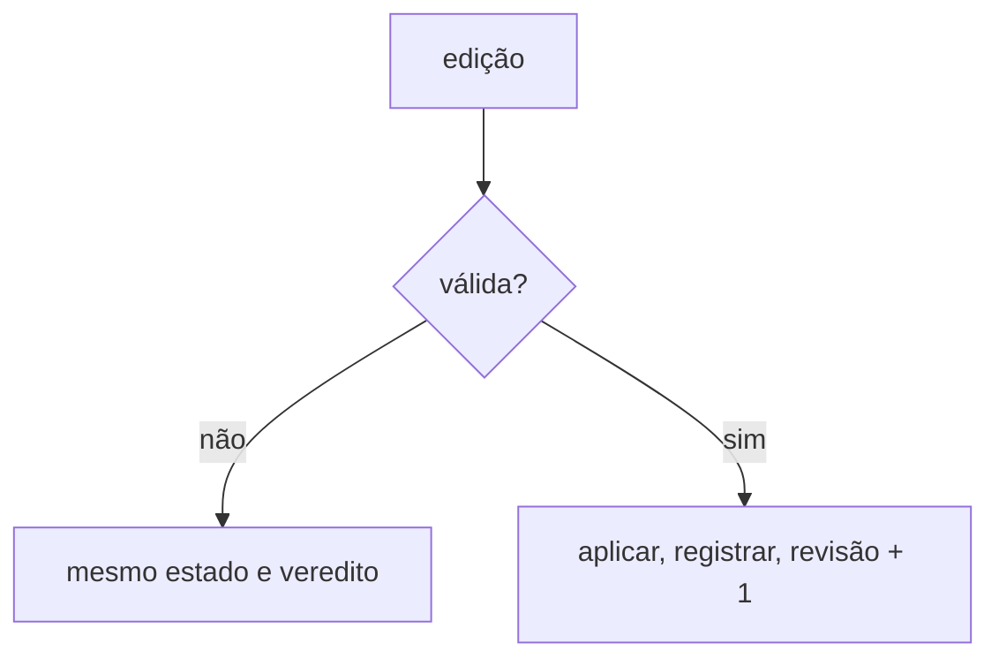

# edit/commitEdit

## Visão geral

Confirma uma edição candidata somente quando o veredito é válido, acrescentando-a ao registro e tornando desatualizados os resultados derivados.

## Responsabilidades

- Descartar o ramo de refazer ao confirmar depois de desfazer.
- Incrementar a revisão e recalcular o frescor.
- Recusar com `EDIT_LOG_FULL` quando o registro está cheio, sem perder histórico.

## Entradas e saídas

```ts
export function commitEdit(state: EditState, edit: CandidateEdit): CommitResult
```

## Fluxo principal



## Tratamento de erros e casos-limite

Um veredito inválido devolve o mesmo objeto de estado. A chave de peça desconhecida lança `RangeError`.

## Exemplos

```ts
const { state: next, verdict } = commitEdit(state, edit)
```

## Dependências e integrações

`./applyEdit`, `./judgePlacement`, `./freshness` e `./layoutKey`.
