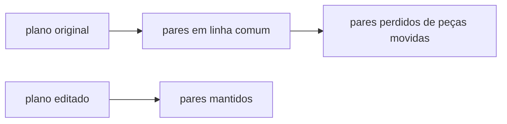

# edit/commonLinesBroken

## Visão geral

Encontra as linhas de corte comum do plano original que o plano editado perdeu e que envolvem uma peça movida.

## Responsabilidades

- Gerar um aviso por peça movida que perdeu uma linha compartilhada.

## Entradas e saídas

```ts
export function commonLinesBroken(state: EditState, next: CutPlanResult): EditNotice[]
```

## Fluxo principal



## Tratamento de erros e casos-limite

Sem plano original não há aviso.

## Exemplos

```ts
const notices = commonLinesBroken(state, result)
```

## Dependências e integrações

`./notice` e `./types`.
