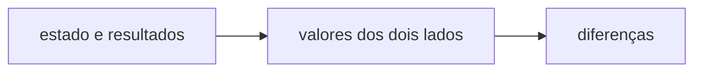

# edit/compareLayouts

## Visão geral

Compara o layout editado com o original: peças que violam uma regra, tempo de corte, custo e quantidade de achados de risco por categoria.

## Responsabilidades

- Dar antes, depois e diferença de cada valor.
- Tratar um valor desatualizado ou indisponível como nulo, com aviso, e nunca como número.

## Entradas e saídas

```ts
export function compareLayouts(request: CompareRequest): ComparisonSummary
```

## Fluxo principal



## Tratamento de erros e casos-limite

O lado editado só entra quando o resultado correspondente está corrente para o layout atual.

## Exemplos

```ts
const summary = compareLayouts({ state, original, edited })
```

## Dependências e integrações

`./createEditState`, `./judgePlacement` e `./notice`.
