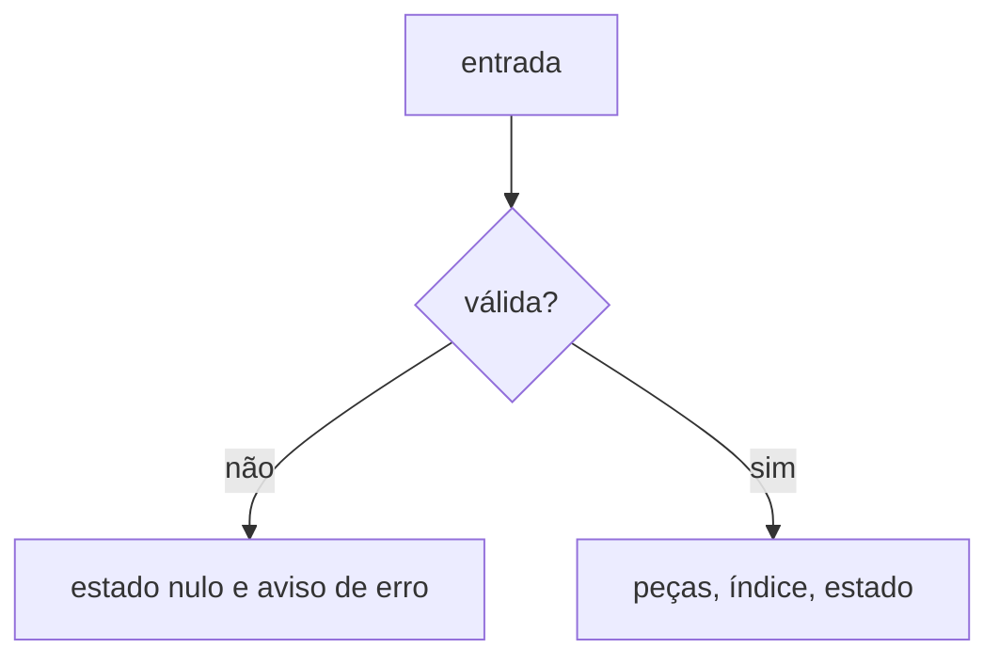

# edit/createEditState

## Visão geral

Inicia uma sessão de edição a partir de um artefato revisado: valida a entrada, resolve as peças, os furos e o índice de vizinhança e devolve o estado imutável.

## Responsabilidades

- Validar o artefato com o esquema da ERP, a versão do contrato, a existência de posicionamentos, os limites e as restrições.
- Montar as peças de trabalho em ordem de artefato, com os contornos de furo do layout de corte.
- Começar com registro vazio, cursor 0, revisão 0 e todos os resultados derivados correntes.

## Entradas e saídas

```ts
export function createEditState(input: EditInput): CreateEditStateResult
```

## Fluxo principal



## Tratamento de erros e casos-limite

`maxLogLength` abaixo de 100 ou não inteiro e trava de fibra sem ângulo dão `INVALID_INPUT`. Peça só com caixa gera `APPROXIMATE_OUTLINE`; peça sem chapa gera `PLACEMENT_SHEET_UNRESOLVED`. Nada é alterado.

## Exemplos

```ts
const { state, notices } = createEditState({ artifact, layout, constraints })
```

## Dependências e integrações

`../erp`, `../linking`, `../cutPath/geometry`, `../linking/neighbourIndex`, `./freshness` e `./notice`.
