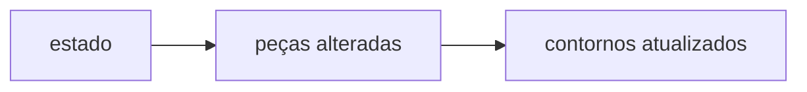

# edit/editedCutLayout

## Visão geral

Produz o layout de corte no cursor: todo contorno de uma peça editada, externo e interno, recebe o posicionamento editado.

## Responsabilidades

- Atualizar contornos de peças alteradas e deixar os demais, as chapas e o ponto inicial como estão.
- Devolver nulo quando a sessão não tinha layout de corte.

## Entradas e saídas

```ts
export function editedCutLayout(state: EditState): CutLayout | null
```

## Fluxo principal



## Tratamento de erros e casos-limite

Sem edições devolve o layout de entrada. O resultado é aceito por `validateCutLayout`.

## Exemplos

```ts
const layout = editedCutLayout(state)
```

## Dependências e integrações

`../cutPath/types`, `../polygonUtils` e `./types`.
