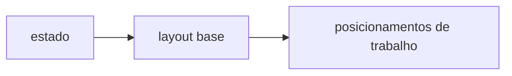

# edit/editedLayout

## Visão geral

Materializa o layout do artefato no cursor da sessão, com os posicionamentos e os posicionamentos compostos editados.

## Responsabilidades

- Substituir os posicionamentos pela versão de trabalho sem alterar o artefato base.
- Atualizar `compoundPlacements` somente quando o original os tem.

## Entradas e saídas

```ts
export function editedLayout(state: EditState): ErpNestingArtifact['layout']
```

## Fluxo principal



## Tratamento de erros e casos-limite

Um artefato sem layout devolve o próprio valor nulo. O registro vazio reproduz o layout base.

## Exemplos

```ts
const layout = editedLayout(state)
```

## Dependências e integrações

`../erp/types` e `./types`.
