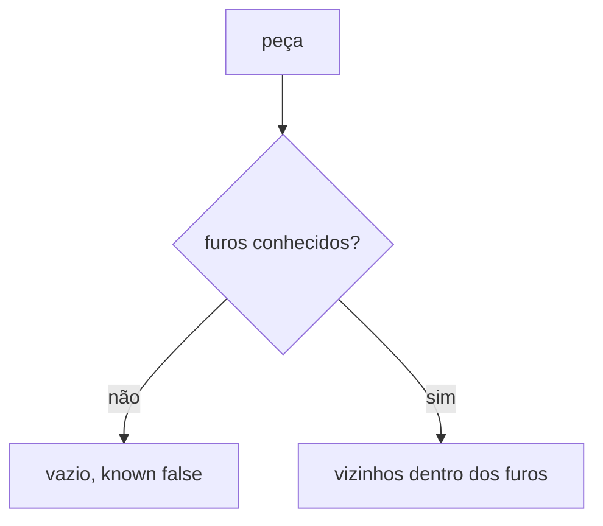

# edit/enclosedGroup

## Visão geral

Encontra as peças que estão dentro dos furos de uma peça e que, por isso, se movem com ela.

## Responsabilidades

- Ler os furos do contorno interno do layout de corte ou dos furos de uma peça composta.
- Indicar quando os furos não podem ser determinados, para o veredito sair aproximado.

## Entradas e saídas

```ts
export interface EnclosedGroup { keys: string[]; known: boolean }
export function enclosedGroup(part: WorkingPart, working: WorkingLayout): EnclosedGroup
```

## Fluxo principal



## Tratamento de erros e casos-limite

Sem layout e sem peça composta o grupo é vazio e `known` é falso. Uma peça dentro do furo de outra não tem grupo próprio.

## Exemplos

```ts
const { keys, known } = enclosedGroup(host, state.working)
```

## Dependências e integrações

`../polygonUtils`, `../linking/neighbourIndex` (via o layout de trabalho) e `./types`.
