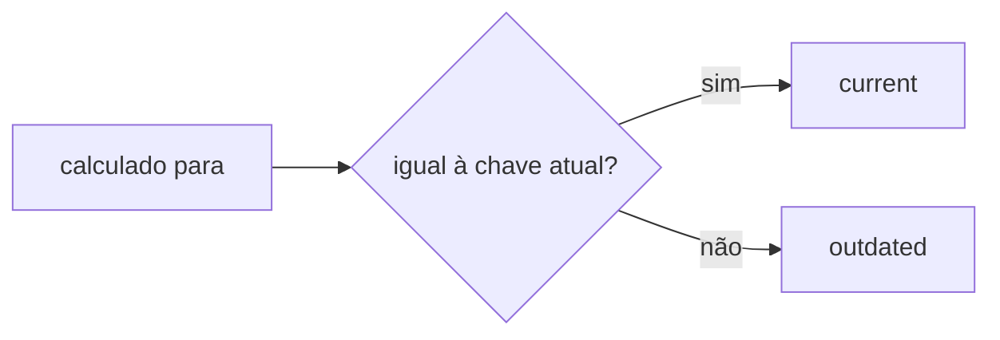

# edit/freshness

## Visão geral

Diz quais resultados derivados (plano, custo, validação e risco) são correntes para o layout no cursor.

## Responsabilidades

- Comparar a chave do layout para a qual cada resultado foi calculado com a chave do layout atual.

## Entradas e saídas

```ts
export function freshness(computedFor: Record<DerivedResult, string | null>, key: string): Freshness
```

## Fluxo principal



## Tratamento de erros e casos-limite

Um resultado nunca calculado fica sempre `outdated`.

## Exemplos

```ts
const state = freshness(computedFor, layoutKey(edits, cursor))
```

## Dependências e integrações

`./types`.
