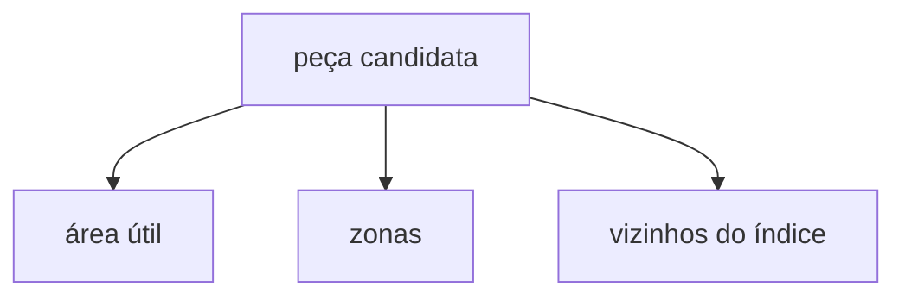

# edit/geometryViolations

## Visão geral

Julga a geometria de uma peça candidata contra a área útil, as zonas proibidas e os vizinhos.

## Responsabilidades

- Reportar sobreposição, saída da área, zonas (furos da chapa e zonas do chamador) e espaçamento.
- Comparar uma peça que cabe inteira num furo de vizinho com o furo, e não com o contorno externo.

## Entradas e saídas

```ts
export function geometryViolations(state: EditState, part: WorkingPart, exclude: ReadonlySet<string>): GeometryViolations
```

## Fluxo principal



## Tratamento de erros e casos-limite

Vizinhos só com caixa marcam `approximateNeighbour`. Reusa os predicados da busca de forma verdadeira, então um layout produzido por ela não tem violações.

## Exemplos

```ts
const found = geometryViolations(state, part, new Set([part.key]))
```

## Dependências e integrações

`../trueShape/bounds`, `../collision`, `../polygonUtils`, `./violation` e `./types`.
