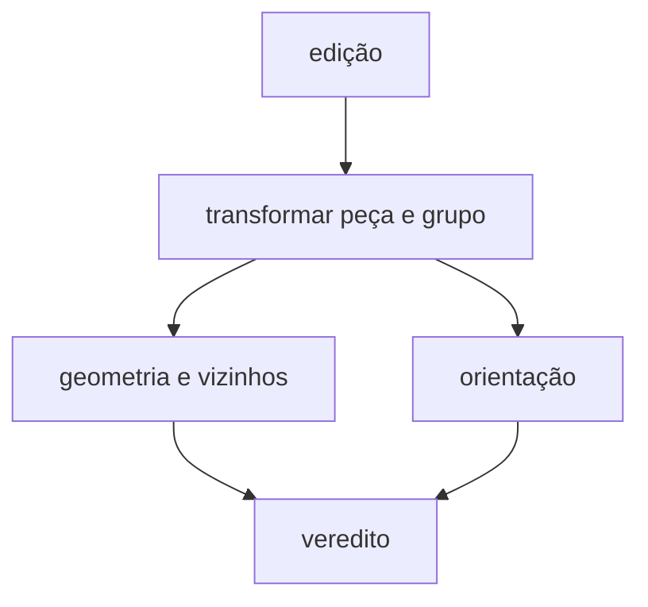

# edit/judgePlacement

## Visão geral

Julga uma edição candidata de uma peça: sobreposição, área útil, zonas proibidas, espaçamento mínimo e regras de orientação.

## Responsabilidades

- Julgar a peça e o grupo interno aos seus furos em conjunto e reportar todas as violações na ordem fixa sobreposição, área, zona, espaçamento, orientação.
- Marcar o veredito como aproximado quando depende de um contorno só de caixa ou de um grupo desconhecido.
- Nunca alterar o estado.

## Entradas e saídas

```ts
export function judgePlacement(state: EditState, edit: CandidateEdit): PlacementVerdict
```

## Fluxo principal



## Tratamento de erros e casos-limite

Lança `RangeError` para uma chave de peça que não está na sessão. Um membro do grupo inválido gera `GROUP_INVALID`.

## Exemplos

```ts
const verdict = judgePlacement(state, { partKey: 'a#0', kind: 'move', delta: { dx: 5, dy: 0 } })
```

## Dependências e integrações

`./geometryViolations`, `./orientationViolations`, `./transformMembers` e `./violation`.
