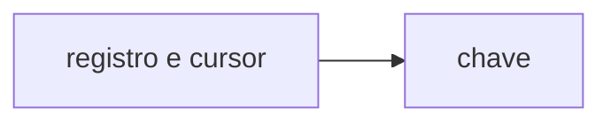

# edit/layoutKey

## Visão geral

Nomeia o layout alcançado após as primeiras edições do registro, para casar um resultado derivado com o layout para o qual foi calculado.

## Responsabilidades

- Produzir uma chave igual exatamente para edições aplicadas iguais.

## Entradas e saídas

```ts
export function layoutKey(edits: readonly PartEdit[], cursor: number): string
```

## Fluxo principal



## Tratamento de erros e casos-limite

Cursor zero dá a chave vazia, a do layout original.

## Exemplos

```ts
const key = layoutKey(state.edits, state.cursor)
```

## Dependências e integrações

`./types`.
