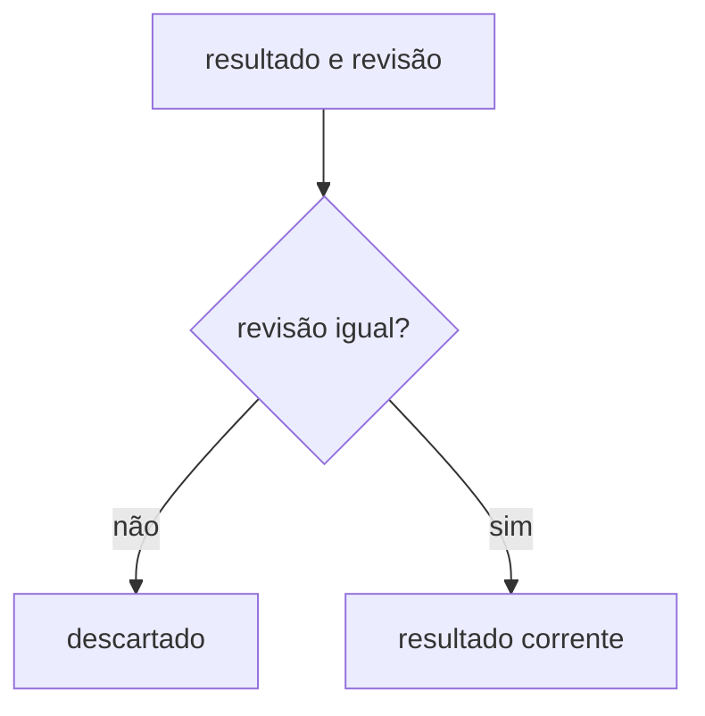

# edit/markComputed

## Visão geral

Registra que um resultado derivado foi calculado para o layout no cursor, descartando o cálculo de uma revisão que o estado já deixou.

## Responsabilidades

- Marcar o resultado corrente apenas quando a revisão do cálculo é a do estado.
- Devolver o mesmo estado e `discarded` verdadeiro para uma revisão defasada.

## Entradas e saídas

```ts
export function markComputed(state: EditState, result: DerivedResult, revision: number): { state: EditState; discarded: boolean }
```

## Fluxo principal



## Tratamento de erros e casos-limite

Um recálculo iniciado antes de uma edição nunca torna o resultado corrente.

## Exemplos

```ts
const { state: next, discarded } = markComputed(state, 'plan', step.revision)
```

## Dependências e integrações

`./freshness`, `./layoutKey` e `./types`.
