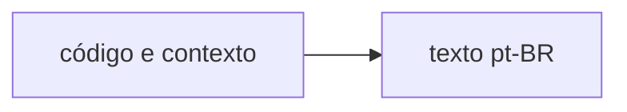

# edit/messages

## Visão geral

Único módulo com os textos de usuário do módulo de edição, em português do Brasil. Interno: não é exportado pelo barril.

## Responsabilidades

- Fornecer um construtor de texto para cada código de violação e de aviso.
- Interpolar identificadores e valores com `formatQuantity`.

## Entradas e saídas

```ts
export const editMessages: {
  violation: Record<ViolationCode, (context: MessageContext) => string>
  notice: Record<EditNoticeCode, (context: MessageContext) => string>
}
```

## Fluxo principal



## Tratamento de erros e casos-limite

Todo código tem texto não vazio; um valor ausente no contexto aparece como texto vazio, e quem chama deve fornecer o necessário.

## Exemplos

```ts
editMessages.violation.OVERLAP({ partKey: 'a#0', otherPartKey: 'b#0' })
```

## Dependências e integrações

`../linking/formatQuantity` e `./types`.
