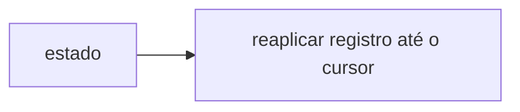

# edit/moveCursor

## Visão geral

Move o cursor do registro e reconstrói o layout reaplicando o registro a partir da base.

## Responsabilidades

- Incrementar a revisão e recalcular o frescor para o novo cursor.

## Entradas e saídas

```ts
export function moveCursor(state: EditState, cursor: number): EditState
```

## Fluxo principal



## Tratamento de erros e casos-limite

O cursor deve estar em `0..edits.length`; quem chama garante.

## Exemplos

```ts
const next = moveCursor(state, state.cursor - 1)
```

## Dependências e integrações

`./replayEdits`, `./freshness` e `./layoutKey`.
