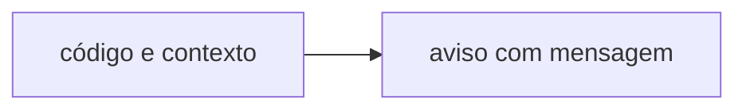

# edit/notice

## Visão geral

Constrói um aviso da edição com a mensagem em português.

## Responsabilidades

- Associar a chave da peça do contexto ao aviso.

## Entradas e saídas

```ts
export function notice(severity, code, context?): EditNotice
```

## Fluxo principal



## Tratamento de erros e casos-limite

Todo código tem mensagem.

## Exemplos

```ts
notice('warning', 'EDIT_LOG_FULL', { limit: 100 })
```

## Dependências e integrações

`./messages`.
