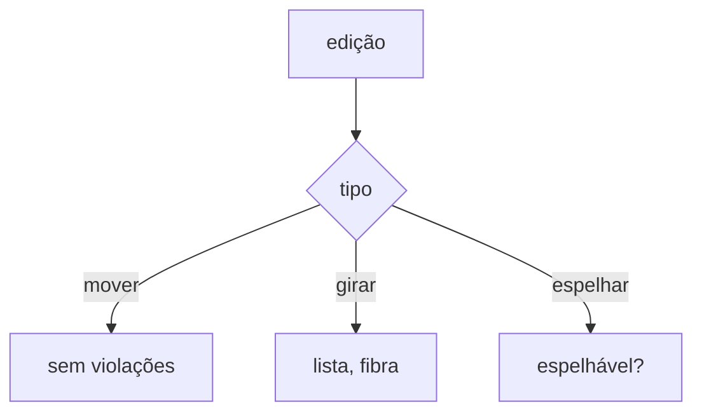

# edit/orientationViolations

## Visão geral

Julga as regras de orientação de uma edição: rotações permitidas, direção da fibra e espelhamento.

## Responsabilidades

- Recusar com `CONSTRAINTS_UNKNOWN` quando as restrições não foram informadas.
- Recusar rotação e espelhamento de uma peça só com caixa.

## Entradas e saídas

```ts
export function orientationViolations(state: EditState, host: WorkingPart, edit: CandidateEdit): Violation[]
```

## Fluxo principal



## Tratamento de erros e casos-limite

Rotação absoluta é comparada módulo 360 com `EPSILON`; a fibra, módulo 180.

## Exemplos

```ts
const found = orientationViolations(state, host, edit)
```

## Dependências e integrações

`../trueShape/rotations`, `../config` e `./violation`.
