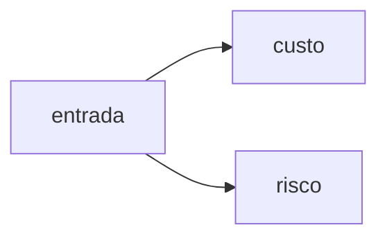

# edit/originalResults

## Visão geral

Calcula o custo e o risco do layout original com o plano de que a sessão partiu, para a comparação com o layout editado.

## Responsabilidades

- Deixar de fora o resultado que não pode ser calculado.

## Entradas e saídas

```ts
export function originalResults(input: EditInput, costModel?: CostModel, riskProfile?: CutRiskProfile): ComparisonInputs
```

## Fluxo principal



## Tratamento de erros e casos-limite

Sem plano de corte original devolve objeto vazio.

## Exemplos

```ts
const original = originalResults(input, costModel, riskProfile)
```

## Dependências e integrações

`../cost/buildCostBreakdown` e `../risk/assessCutRisk`.
