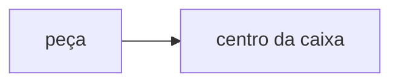

# edit/pivotOf

## Visão geral

Centro da caixa do contorno externo de uma peça: o pivô de rotações e espelhamentos.

## Responsabilidades

- Fornecer o pivô comum da peça e do seu grupo.

## Entradas e saídas

```ts
export function pivotOf(part: WorkingPart): Point2D
```

## Fluxo principal



## Tratamento de erros e casos-limite

Contorno externo com menos de um ponto não é esperado.

## Exemplos

```ts
const pivot = pivotOf(host)
```

## Dependências e integrações

`../polygonUtils`.
