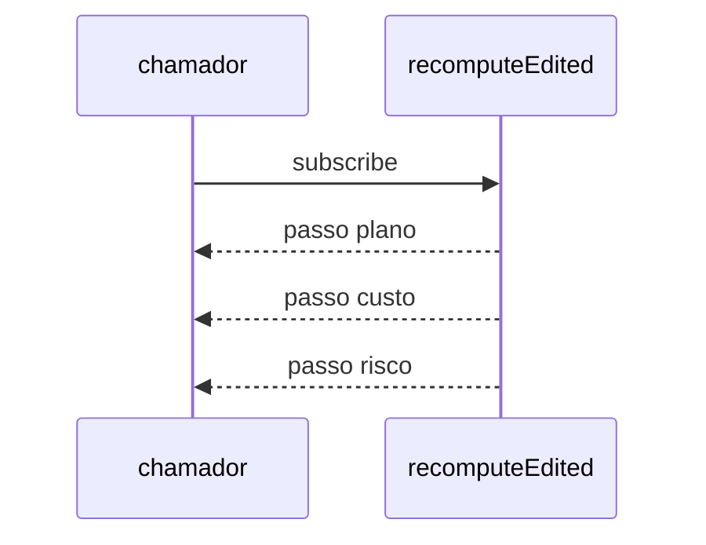

# edit/recomputeEdited

## Visão geral

Recalcula o que depende do layout editado: o plano de corte e, quando informados, o custo e o risco.

## Responsabilidades

- Emitir um passo por resultado pedido, na ordem plano, custo, risco, cada um com a revisão de que partiu.
- Manter o layout editado quando um passo falha e marcar os passos que dependem dele como indisponíveis.
- Avisar quando mover uma peça desfaz uma linha de corte comum.

## Entradas e saídas

```ts
export function recomputeEdited(request: RecomputeRequest): Observable<RecomputeStep>
```

## Fluxo principal



## Tratamento de erros e casos-limite

Um pedido sem estado rejeita o Observable com `TypeError`. Cada assinatura recalcula, e nenhuma entrada é alterada.

## Exemplos

```ts
recomputeEdited({ state, processProfile, costModel }).subscribe((step) => console.log(step.step, step.status))
```

## Dependências e integrações

`../cutPath/plan`, `../cost/buildCostBreakdown`, `../risk/assessCutRisk` e `./editedCutLayout`.
