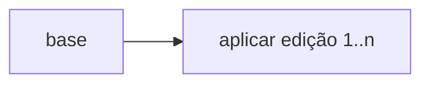

# edit/replayEdits

## Visão geral

Reconstrói o layout após as primeiras edições do registro, a partir da base.

## Responsabilidades

- Reaplicar as edições em ordem para que desfazer e refazer reproduzam exatamente cada estado.

## Entradas e saídas

```ts
export function replayEdits(base: WorkingLayout, edits: readonly PartEdit[], count: number): WorkingLayout
```

## Fluxo principal



## Tratamento de erros e casos-limite

Com `count` zero devolve a base.

## Exemplos

```ts
const working = replayEdits(base, edits, cursor)
```

## Dependências e integrações

`./applyEdit`.
