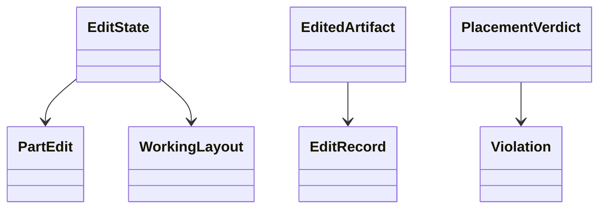

# edit/types

## Visão geral

Tipos públicos do módulo de edição: entrada da sessão, restrições, edições candidatas e confirmadas, veredito de posição, estado imutável, resultado editado, recálculo e comparação.

## Responsabilidades

- Definir o contrato de dados da edição, sem lógica.
- Manter as faixas e regras dos campos documentadas no JSDoc: `maxLogLength` padrão 100 e inteiro >= 100; `grainLocked` exige `grainAngle`; o veredito é válido somente sem violações.
- Declarar o `revision` do estado, que cresce a cada confirmação, desfazer e refazer, e o descarte de recálculos defasados.

## Entradas e saídas

```ts
export interface EditInput { artifact; layout?; cutPlan?; constraints?; limits? }
export type CandidateEdit = { partKey; kind: 'move'; delta } | { partKey; kind: 'rotate'; delta } | { partKey; kind: 'mirror' }
export interface PlacementVerdict { valid; violations; approximate; group }
export interface EditState { input; maxLogLength; edits; cursor; revision; freshness; computedFor; working }
```

## Fluxo principal



## Tratamento de erros e casos-limite

Os tipos não validam valores; a validação fica em `createEditState` e nos juízes de posição.

## Exemplos

```ts
const verdict: PlacementVerdict = judgePlacement(state, { partKey: 'a#0', kind: 'move', delta: { dx: 1, dy: 0 } })
```

## Dependências e integrações

Tipos de `../erp`, `../cutPath`, `../cost`, `../risk` e `../types`.
