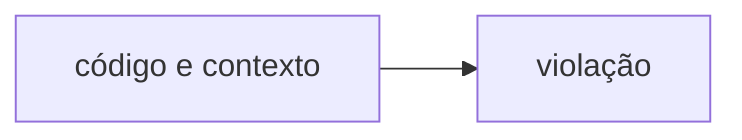

# edit/violation

## Visão geral

Constrói uma violação de posição com a mensagem em português.

## Responsabilidades

- Manter a peça, a outra peça e a zona no objeto da violação.

## Entradas e saídas

```ts
export function violation(code: ViolationCode, context: MessageContext): Violation
```

## Fluxo principal



## Tratamento de erros e casos-limite

Todo código tem mensagem.

## Exemplos

```ts
violation('OVERLAP', { partKey: 'a#0', otherPartKey: 'b#0' })
```

## Dependências e integrações

`./messages`.
