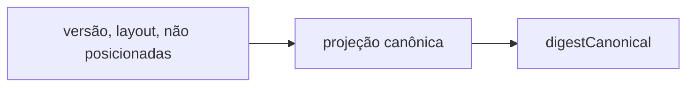

# outputProjection

## Visão geral

Monta a projeção canônica cujo SHA-256 é o `outputDigest` de um artefato. É a única definição dessa projeção: o construtor do artefato e o resultado editado da edição usam o mesmo código.

## Responsabilidades

- Projetar layout, chapas selecionadas, posicionamentos, não posicionadas e métricas.
- Não alterar o layout nem a lista de não posicionadas.

## Entradas e saídas

```ts
export function outputProjection(contractVersion: number, plan: NestResponse, unplaced: readonly ErpUnplacedItem[]): CanonicalInput
```

## Fluxo principal



## Tratamento de erros e casos-limite

A projeção não valida o layout; quem chama já validou o artefato. Entradas iguais dão projeções iguais.

## Exemplos

```ts
const digest = await digestCanonical(outputProjection(1, artifact.layout, artifact.unplaced))
```

## Dependências e integrações

`./canonical` e `../types`.
