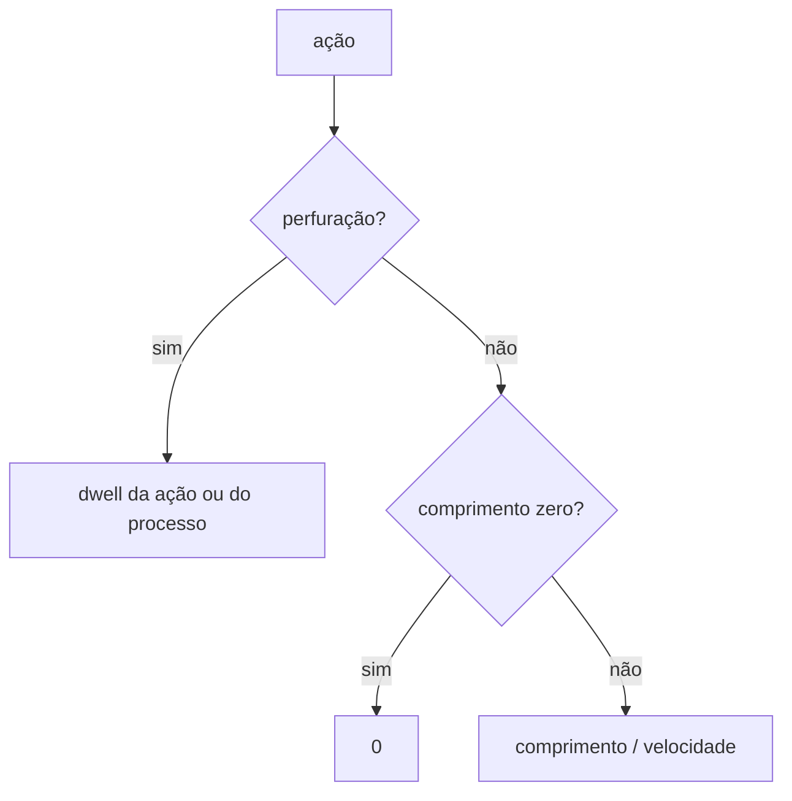

# actionDuration

## Visão geral

Calcula a duração de uma ação a partir do comprimento, das velocidades do processo e dos metadados `feed` e `dwell` da própria ação. Compartilhado pelo custo e pelo risco, que por isso concordam sobre a linha do tempo do corte.

## Responsabilidades

- Converter comprimento em segundos com `geometryUnitsPerMeter`.
- Dar precedência ao `feed` e ao `dwell` da ação sobre as velocidades do processo.
- Devolver `null` quando falta a velocidade ou o tempo de perfuração necessário, nunca um palpite.

## Entradas e saídas

```ts
export interface TimedAction { category: ActionCategory; length: number; feed: number | null; dwell: number | null }
export interface ActionSpeeds { cutting?: number; rapid?: number; pierceDwellSeconds?: number }
export function actionDuration(action: TimedAction, speeds: ActionSpeeds, geometryUnitsPerMeter: number): number | null
```

## Fluxo principal



## Tratamento de erros e casos-limite

Comprimento zero dá zero segundos. Velocidade ausente ou não positiva dá `null`. Perfuração sem tempo dá `null`.

## Exemplos

```ts
actionDuration({ category: 'cut', length: 1000, feed: null, dwell: null }, { cutting: 6 }, 1000) // 10
```

## Dependências e integrações

`./actionCategory`.
