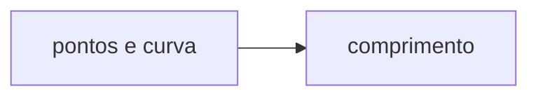

# actionLength

## Visão geral

Mede o comprimento geométrico de uma ação ao longo dos pontos, do arco ou da bezier. Compartilhado pela revisão e pelo custo.

## Responsabilidades

- Ser a única medida de comprimento de ação do projeto, baseada em `sampleActionPath`.

## Entradas e saídas

```ts
export function actionLength(points: readonly Point2D[], curve: CutCurve | undefined): number
```

## Fluxo principal



## Tratamento de erros e casos-limite

Menos de dois pontos resulta em comprimento zero.

## Exemplos

```ts
const length = actionLength(action.points, action.curve)
```

## Dependências e integrações

`./actionPath` e `../polygonUtils`.
