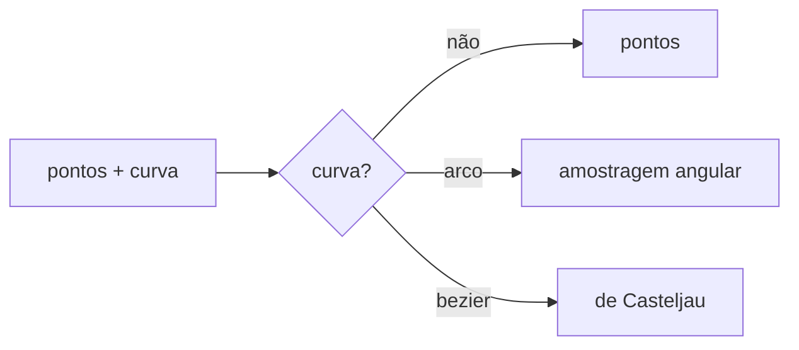

# sampleActionPath

## Visão geral

Discretiza a geometria de uma ação em uma polilinha. Compartilhado pela revisão e pelo custo.

## Responsabilidades

- Manter pontos lineares como estão.
- Amostrar arcos pelo ângulo varrido (360 segmentos por volta) e beziers com 32 amostras.

## Entradas e saídas

```ts
export function sampleActionPath(points: readonly Point2D[], curve: CutCurve | undefined): Point2D[]
```

## Fluxo principal



## Tratamento de erros e casos-limite

Arco com início e fim coincidentes vira circunferência completa. Menos de dois pontos ou sem curva devolve cópia dos pontos.

## Exemplos

```ts
const path = sampleActionPath(action.points, action.curve)
```

## Dependências e integrações

`../polygonUtils`, `../config` e `../cutPath/types`.
