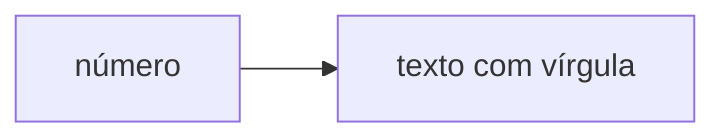

# formatQuantity

## Visão geral

Formata um número para texto de usuário em português do Brasil, com vírgula decimal e sem depender do locale do ambiente. Compartilhado pelas mensagens da edição e do risco.

## Responsabilidades

- Arredondar para no máximo três casas decimais.
- Remover zeros à direita e usar vírgula como separador decimal.

## Entradas e saídas

```ts
export function formatQuantity(value: number): string
```

## Fluxo principal



## Tratamento de erros e casos-limite

Números inteiros não ganham casas decimais. Valores não finitos não são esperados: quem chama já validou.

## Exemplos

```ts
formatQuantity(3.5) // '3,5'
```

## Dependências e integrações

Nenhuma.
