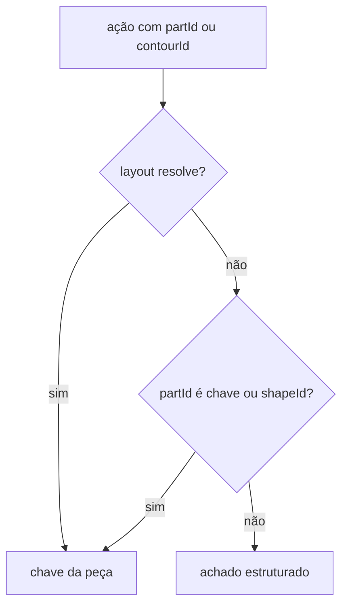

# linkActions

## Visão geral

Vincula as ações de corte às peças posicionadas. Compartilhado pela revisão e pelo custo; não produz texto para o usuário.

## Responsabilidades

- Resolver contorno para posição pelo `CutLayout` e, depois, `partId` igual à chave da peça ou ao `shapeId`.
- Devolver cada referência não resolvida uma só vez, como achado estruturado (`unknown-part` ou `unlinked-action`).
- Expor o mesmo resolvedor para problemas de planejamento.

## Entradas e saídas

```ts
export function linkActions(args: LinkActionsArgs): LinkActionsResult
```

## Fluxo principal



## Tratamento de erros e casos-limite

Ação sem `partId` e sem `contourId` (por exemplo `end`) não gera achado. A ação continua na sequência.

## Exemplos

```ts
const { partKeyByAction, unresolved } = linkActions({ partKeys, layout, actions })
```

## Dependências e integrações

`../cutPath/types`.
