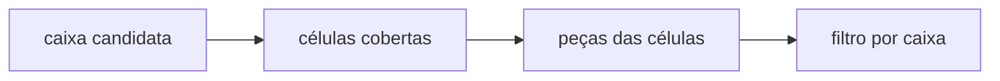

# neighbourIndex

## Visão geral

Grade uniforme das caixas das peças de uma chapa, para que o veredito olhe só os vizinhos do candidato.

## Responsabilidades

- Devolver, em ordem estável de inserção, as peças cuja caixa encontra a caixa consultada ampliada por uma margem.
- Substituir a caixa de uma peça sem alterar o índice original.

## Entradas e saídas

```ts
export interface NeighbourIndex { query(bbox, margin): string[]; with(key, bbox): NeighbourIndex }
export function createNeighbourIndex(entries, cellSize): NeighbourIndex
```

## Fluxo principal



## Tratamento de erros e casos-limite

Uma peça maior que a célula entra em todas as células que cobre. O índice é imutável; `with` copia só as células afetadas.

## Exemplos

```ts
const near = index.query(candidateBox, spacing)
```

## Dependências e integrações

`../types`.
