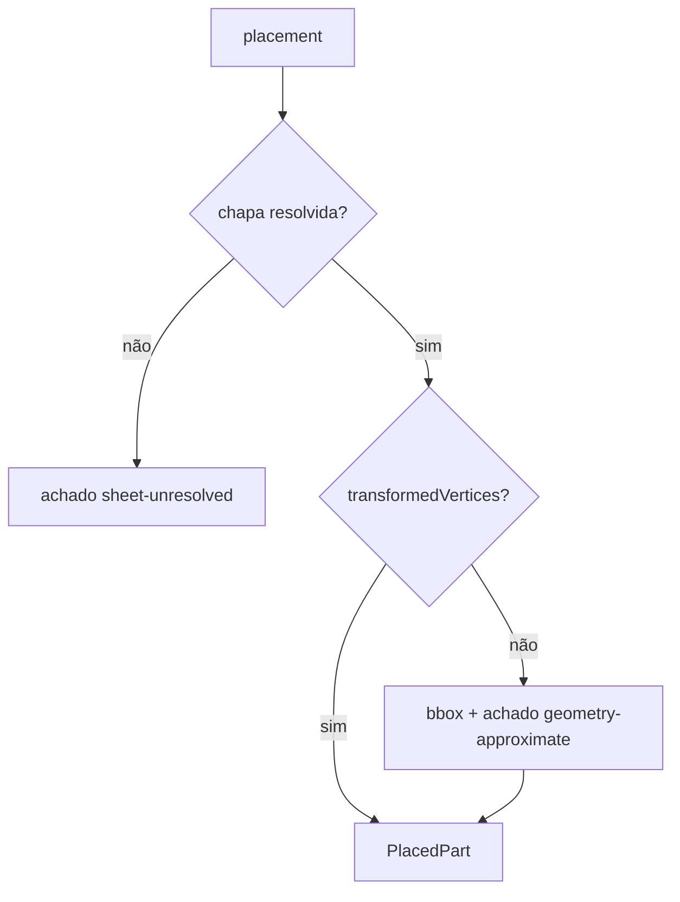

# placedParts

## Visão geral

Transforma os placements do artefato em peças por chapa sem descartar nem adivinhar nenhum. Compartilhado pela revisão e pelo custo; não produz texto para o usuário.

## Responsabilidades

- Chapa: `sheetId`, senão a única chapa, senão achado `sheet-unresolved` e nenhuma peça.
- Instância: `instanceIndex`, senão a ordem entre placements da mesma forma.
- Contorno: `transformedVertices`, senão o retângulo `bbox` com a peça marcada como aproximada (`geometry-approximate`).
- Placement composto: uma peça com os contornos externo e dos furos.

## Entradas e saídas

```ts
export function placedParts(layout: ArtifactLayout, sheets: readonly StockItem[]): PlacedParts
```

## Fluxo principal



## Tratamento de erros e casos-limite

Todos os placements aparecem como peça ou como achado; nada é descartado em silêncio.

## Exemplos

```ts
const { partsBySheet, findings } = placedParts(layout, stocks)
```

## Dependências e integrações

`../erp/types` e `../types`.
