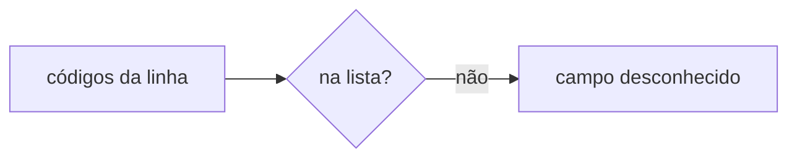

# codeLists

## Visão geral

Listas de códigos do cut chart definidas pelo fabricante (tipos de tocha, materiais, correntes, gases, espessuras e superfícies). Interno.

## Responsabilidades

- Reconhecer os códigos que o Programmer Reference 809550 define.
- Apontar o primeiro código desconhecido de uma linha.

## Entradas e saídas

```ts
export function unknownChartField(chart: CutChartCodes): keyof CutChartCodes | undefined
```

## Fluxo principal



## Tratamento de erros e casos-limite

O material aceita a casa decimal do material específico (`1.99`). A superfície é opcional.

## Exemplos

```ts
unknownChartField({ type: 34, material: 1, current: 130, gas: 99, thickness: 29 }) // 'gas'
```

## Dependências e integrações

`./types`.
