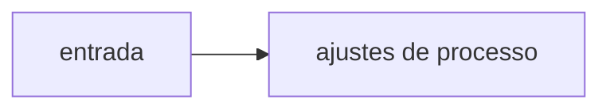

# cutChartSettings

## Visão geral

Converte uma entrada da tabela de corte nos ajustes de processo lidos pelo processador da Hypertherm.

## Responsabilidades

- Mapear os códigos do cut chart, as alturas, o kerf, o avanço e as opções `M50N`, `RT`, `HS`.
- Marcar `chartSource: table` para evitar o aviso de cut chart não verificado.

## Entradas e saídas

```ts
export function cutChartSettings(entry: CutChartEntry): Record<string, boolean | number | string>
```

## Fluxo principal



## Tratamento de erros e casos-limite

Valores ausentes na linha ficam fora do resultado (nenhum padrão é inventado).

## Exemplos

```ts
const settings = cutChartSettings(found.entry)
```

## Dependências e integrações

`./types`.
