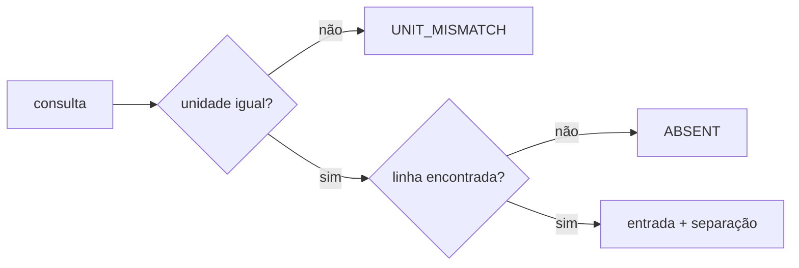

# findCutChartEntry

## Visão geral

Consulta exata de uma entrada da tabela de corte por material, espessura, classe e opções.

## Responsabilidades

- Devolver a entrada e a regra de separação, ou a ausência explícita.
- Nunca usar a espessura ou a classe vizinha.
- Devolver `CUTCHART_UNIT_MISMATCH` quando a unidade difere, sem converter.
- Montar o índice uma vez por tabela.

## Entradas e saídas

```ts
export function findCutChartEntry(table: CutChartTable, query: CutChartQuery, unit: CutChartUnit): CutChartFound | CutChartAbsence
```

## Fluxo principal



## Tratamento de erros e casos-limite

A espessura é comparada em milésimos. Várias linhas: perfil genérico (`*`) primeiro, depois a ordem do arquivo.

## Exemplos

```ts
const found = findCutChartEntry(table, { material: 'MS', thickness: 6, class: '130Amp O2/Air' }, 'mm')
```

## Dependências e integrações

`../../config`, `../machine/messages`.
