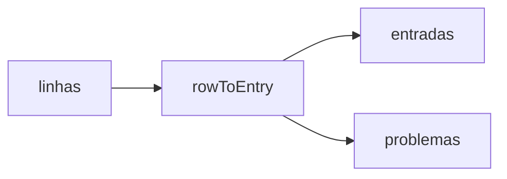

# importCutChartTable

## Visão geral

Importa a tabela de corte Phoenix a partir de linhas entregues pelo chamador. A biblioteca não lê arquivos.

## Responsabilidades

- Ler a unidade do marcador e recusar a tabela sem unidade válida.
- Converter cada linha em entrada, relatando as inválidas sem perder as demais.
- Importar as regras de separação por espessura.

## Entradas e saídas

```ts
export function importCutChartTable(input: CutChartInput): { table?: CutChartTable; issues: readonly CutChartIssue[] }
```

## Fluxo principal



## Tratamento de erros e casos-limite

Unidade ausente ou desconhecida gera `CUTCHART_UNIT_MISSING` e nenhuma tabela. A entrada não é alterada.

## Exemplos

```ts
const { table, issues } = importCutChartTable({ unitMarker: 'mm', rows })
```

## Dependências e integrações

`./rowToEntry`, `./rowReader`, `../machine/messages`.
