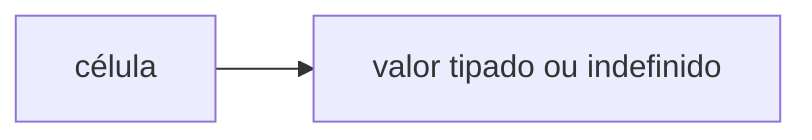

# rowReader

## Visão geral

Leitores das células de uma linha da tabela de corte. Interno.

## Responsabilidades

- Ler número, texto e opção (liga/desliga) de uma célula.
- Aceitar texto numérico e devolver `undefined` para o que não pode ser lido.

## Entradas e saídas

```ts
export const cells: { number(cell): number | undefined; text(cell): string | undefined; flag(cell): boolean; optional(row, column): number | undefined }
```

## Fluxo principal



## Tratamento de erros e casos-limite

Texto não numérico em coluna numérica resulta em `undefined`; quem chama decide se a linha é inválida.

## Exemplos

```ts
cells.number('4035') // 4035
```

## Dependências e integrações

`./types`.
