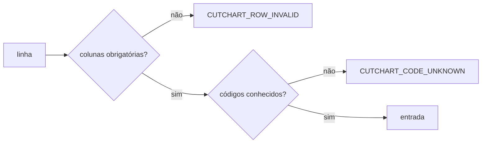

# rowToEntry

## Visão geral

Converte uma linha do workbook em uma entrada de corte, ou no problema que a invalida. Interno.

## Responsabilidades

- Exigir material, classe e as colunas numéricas obrigatórias.
- Conferir os códigos do cut chart contra as listas do fabricante.
- Montar avanço, kerf, alturas, opções e saídas da entrada.

## Entradas e saídas

```ts
export function rowToEntry(row: CutChartRow, rowNumber: number): { entry: CutChartEntry } | { issue: CutChartIssue }
```

## Fluxo principal



## Tratamento de erros e casos-limite

Linha inválida é relatada com seu número e deixada de fora; as demais são mantidas.

## Exemplos

```ts
const result = rowToEntry(row, 2)
```

## Dependências e integrações

`./codeLists`, `./rowReader`, `../machine/messages`.
