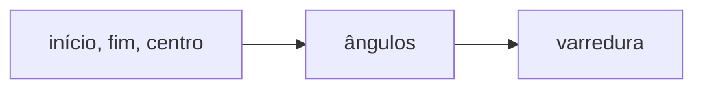

# arcSweep

## Visão geral

Calcula o ângulo varrido por um arco, em graus. Interno aos dialetos.

## Responsabilidades

- Tratar início igual ao fim como círculo completo (360).
- Respeitar o sentido horário ou anti-horário.

## Entradas e saídas

```ts
export function arcSweep(start: Point2D, end: Point2D, center: Point2D, clockwise: boolean): number
```

## Fluxo principal



## Tratamento de erros e casos-limite

Usa `EPSILON` para detectar o círculo completo.

## Exemplos

```ts
arcSweep({ x: 10, y: 0 }, { x: 0, y: 10 }, { x: 0, y: 0 }, false) // 90
```

## Dependências e integrações

`../../config`.
