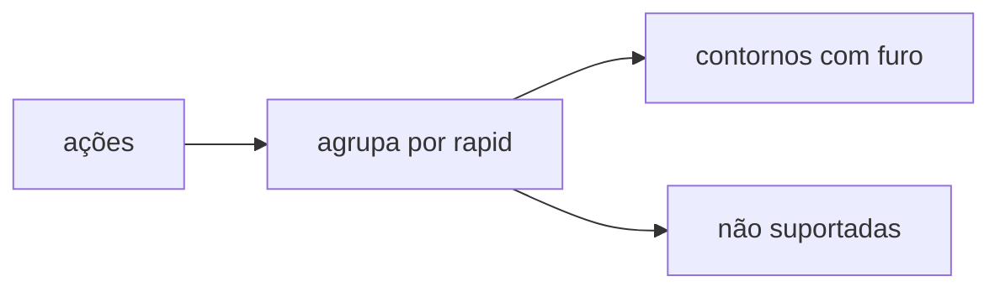

# contourBlocks

## Visão geral

Divide um plano de corte plano em contornos para os dialetos que escrevem um bloco por contorno (Talvi e GloryStar). Interno.

## Responsabilidades

- Agrupar a partir de cada `rapid` o furo e os movimentos seguintes.
- Calcular a distância do último ponto até o início do próximo contorno.
- Devolver separadamente as ações `tab` e `common-line`, sem achatá-las.

## Entradas e saídas

```ts
export function splitContours(plan: CutPlan): { contours: readonly Contour[]; unsupported: readonly UnsupportedAction[] }
```

## Fluxo principal



## Tratamento de erros e casos-limite

Grupo sem furo não é contorno (o validador do orquestrador acusa corte sem furo). O plano não é alterado.

## Exemplos

```ts
const { contours } = splitContours(plan)
contours[0].nextRapidLength
```

## Dependências e integrações

`../../cutPath`, `../../types`.
