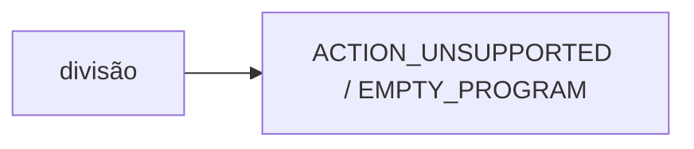

# contourIssues

## Visão geral

Problemas de divisão em contornos comuns aos dialetos por contorno. Interno.

## Responsabilidades

- Acusar ações não suportadas (`tab`, `common-line`).
- Acusar plano sem contornos.

## Entradas e saídas

```ts
export function contourIssues(split: ContourSplit): readonly ValidationIssue[]
```

## Fluxo principal



## Tratamento de erros e casos-limite

Plano vazio nunca é liberável.

## Exemplos

```ts
contourIssues(splitContours(plan))
```

## Dependências e integrações

`./contourBlocks`, `../machine/messages`.
